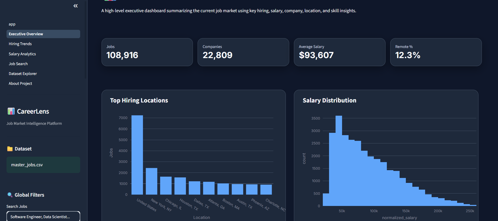
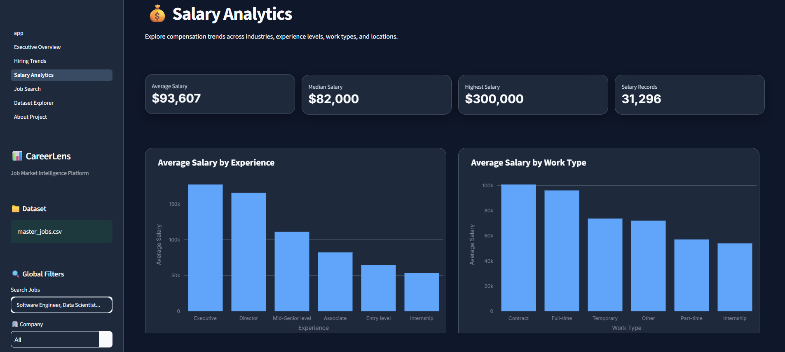
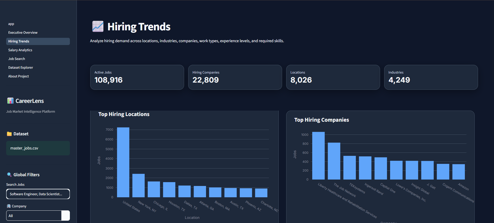

# CareerLens: Job Market Analytics Platform

An end-to-end analytics project on **123,849 LinkedIn job postings**. It covers a Python data pipeline, a SQLite analytics database, an interactive Streamlit dashboard and a Power BI report, all built to answer one question: what does the hiring market actually look like?




---

## What it answers

- Which industries, companies and locations are hiring the most?
- How do salaries vary by experience level, industry and remote status?
- Which skills appear most often in job postings?
- How has hiring volume changed month to month?

Written findings are in [`reports/`](reports/). Start with the [executive summary](reports/executive_summary.md) and [business insights](reports/business_insights.md).

## Dashboard

The Streamlit app has six pages:

| Page | What's on it |
|---|---|
| Executive Overview | KPI cards and headline hiring metrics |
| Hiring Trends | Monthly and yearly posting volume, experience-level mix |
| Salary Analytics | Salary distributions, salary vs. experience and remote status |
| Job Search | Search and filter postings by company, location, experience and remote work |
| Dataset Explorer | Browse the cleaned dataset directly |
| About Project | Methodology and data notes |

<p>
  
  
</p>

A matching Power BI report is in [`powerbi/CareerLens.pbix`](powerbi/CareerLens.pbix).

## Pipeline

```text
LinkedIn job postings (raw CSVs: postings, skills, industries, salaries)
        │
        ▼
Integration      → join postings with skills, industries and salary tables
        │
        ▼
Cleaning         → deduplicate, handle missing values, normalise salaries
        │
        ▼
Feature eng.     → experience tiers, salary tiers, remote flag, skill counts
        │
        ▼
Validation       → data quality report (reports/data_quality_report.md)
        │
        ▼
SQLite + star-schema CSVs (fact_jobs, dim_company, dim_skill, …)
        │
   ┌────┴─────┐
   ▼          ▼
Streamlit   Power BI
```

SQL used for the analysis is in [`sql/analytics_queries.sql`](sql/analytics_queries.sql). Static charts generated by the pipeline are in [`visualizations/`](visualizations/).

## Dataset

The data comes from the **LinkedIn Job Postings (2023–2024)** dataset on [Kaggle](https://www.kaggle.com/datasets/arshkon/linkedin-job-postings). The raw and processed data are not committed because of their size.

To reproduce:

1. Download the dataset and extract it to `data/raw/linkedin_job_postings/`.
2. Build the master dataset: `python scripts/integrate_datasets.py`
3. Clean and engineer features (see [`notebooks/01_data_preparation.ipynb`](notebooks/01_data_preparation.ipynb) and the cleaning scripts in [`scripts/`](scripts/)).
4. Run the analytics phase (SQL analysis, KPIs, Power BI export, reports): `python scripts/run_phase2.py`

## Running the dashboard

```bash
git clone https://github.com/Bhanoday777/CareerLens.git
cd CareerLens
python -m venv venv
# Windows: venv\Scripts\activate   |   macOS / Linux: source venv/bin/activate
pip install -r requirements.txt
streamlit run app.py
```

The dashboard reads from `data/processed/`, so run the pipeline above first.

## Tech stack

| Category | Tools |
|---|---|
| Language | Python |
| Data processing | pandas, NumPy |
| Database | SQLite, SQLAlchemy |
| Visualisation | Plotly, Altair, Matplotlib |
| Dashboards | Streamlit, Power BI |

## Project structure

```text
CareerLens/
├── app.py              # Streamlit entry point
├── pages/              # Dashboard pages
├── components/         # Reusable UI pieces (cards, charts, tables)
├── utils/              # Data loading, filters, theming
├── scripts/            # Data pipeline
├── sql/                # Analytics queries
├── notebooks/          # Data preparation and analysis notebooks
├── reports/            # Generated written reports
├── visualizations/     # Generated static charts
├── powerbi/            # Power BI report
└── Screenshots/        # README images
```

## Roadmap

- Salary prediction model
- Resume-to-job matching
- Cloud deployment of the dashboard

## Author

**Bhanoday Kurma**, [GitHub](https://github.com/Bhanoday777)
